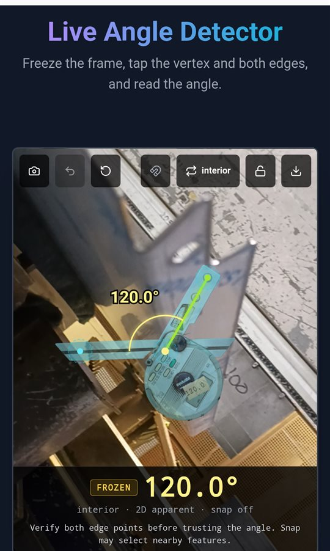
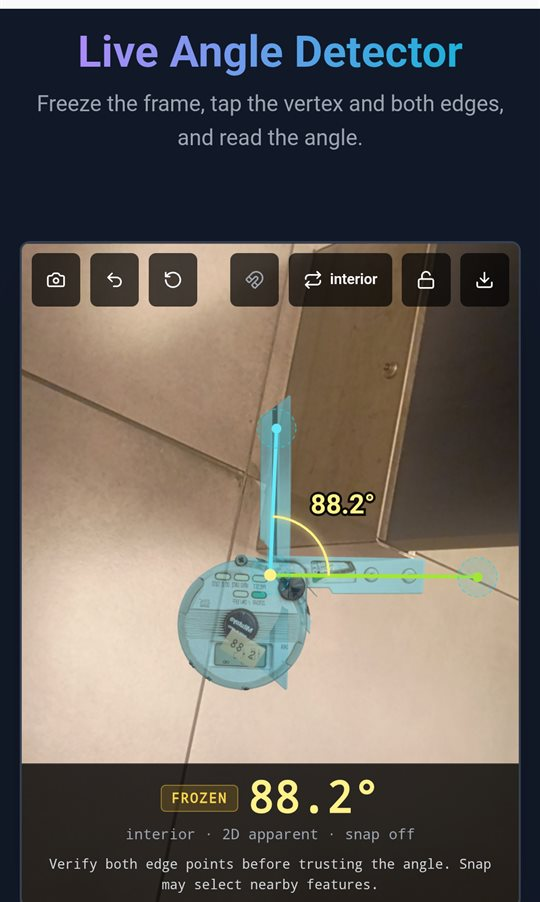

<div align="center">


# Angle Lens

**Measure bend angles from your phone camera, with a 3D Mitutoyo digital protractor laid over the part.**

React · TypeScript · Vite · three.js · Capacitor (Android)


&nbsp;&nbsp;


<sub>AR Lock on a Moto G Power: the reading comes from the handles placed on each edge; the protractor follows them.</sub>

</div>

## What it does

Point the camera at a bend, freeze the frame, and place three points: the vertex and one point on each edge. Angle Lens draws the angle, shows the reading in large type, and lays a 3D Mitutoyo digital protractor along the two edges with the same value on its LCD.

## Features

- **AR Lock.** A faint 3D protractor hovers at the crosshair on the live camera. Aim the bend at it and tap **AR Lock**: the frame freezes with the vertex on the crosshair and both arms pre-placed. Drag each handle onto its edge, and the protractor's arm and blade follow. Locking turns it solid and shows `HOLD`.
- **Manual protractor.** Freeze any frame, or open a photo from the gallery, and tap the vertex and both edges yourself. Drag handles to fine-tune, with undo and reset.
- **Angle conventions.** Switch between interior, supplement and exterior.
- **Snap to edge (optional, off by default).** Moves an edge point onto the nearest strong edge in the image. Check where it landed before trusting the reading.
- **Lock and save.** Lock the result so it can't be bumped, and save an annotated PNG of the frame.
- **Works offline.** Everything except the optional AI assist runs on the device; no account or network needed.
- **Optional AI assist.** With a Gemini API key set, an **Analyze** button asks Gemini to find the angle in the frame. Its points can be used as a starting placement; the reading is then computed from those points by the same geometry, after you check them.

## Measurement limits

- The reading is a **2D apparent angle**, computed geometrically from the points you place (`src/measurement/measureFromPoints.ts`). Hold the camera square to the bend; viewing at an angle changes the apparent value.
- Edges are placed by you, not auto-detected. The 3D protractor is presentation only: it never computes or changes a value, and it is drawn on the frozen image, not tracked in 3D space.
- No calibration or accuracy claim has been made for camera measurements. Use a physical protractor where the tolerance matters.

## Android app

Angle Lens is packaged for Android with Capacitor 7 (`com.ingenuous.angledetector`). It has been built and run on a Moto G Power.

Toolchain: Node 20+, **JDK 21**, Android SDK (`platform-tools`, `platforms;android-35`, `build-tools;35.0.0`).

```bash
npm install
npm run build
npx cap sync android
cd android && ./gradlew assembleDebug   # -> android/app/build/outputs/apk/debug/app-debug.apk
adb install -r app/build/outputs/apk/debug/app-debug.apk
```

Without adb, copy `app-debug.apk` to the phone and open it from Files (allow "Install unknown apps" for Files when asked). The app asks for camera permission on first use.

On Windows, if Gradle fails with "Unable to establish loopback connection", point `TEMP`/`TMP` and `JAVA_TOOL_OPTIONS=-Djdk.net.unixdomain.tmpdir=<short dir>` at a short local folder.

## Run in the browser

**Prerequisites:** Node.js 20+

```bash
npm install
npm run dev        # http://localhost:3000
```

To enable the optional AI assist, put `GEMINI_API_KEY=<your key>` in `.env.local`.

Test AR Lock without a camera: `http://localhost:3000/?photo=/fixtures/mitutoyo-digital-protractor/mitutoyo_center.jpg&ar=1`

## Development

```bash
npm test           # Vitest unit tests
npm run lint       # TypeScript type check
npm run build      # production build into dist/
```

| Path | What's there |
| --- | --- |
| `components/` | Camera screen and angle read-out |
| `src/measurement/`, `src/geometry/` | Angle maths from placed points |
| `src/vision/` | Optional snap-to-edge |
| `src/render/` | Manual protractor, annotated PNG export |
| `src/ar/` | 3D Mitutoyo overlay and its pose maths |
| `scripts/prepare-mitutoyo-model.mjs` | Builds `public/models/mitutoyo-protractor.glb` from the Hi3D scan (simplifies it, splits the blade from the body, fits the pivot into `src/ar/mitutoyoRig.json`) |
| `android/` | Capacitor Android project |
| `docs/` | Android plan, acceptance plan, baseline notes |
